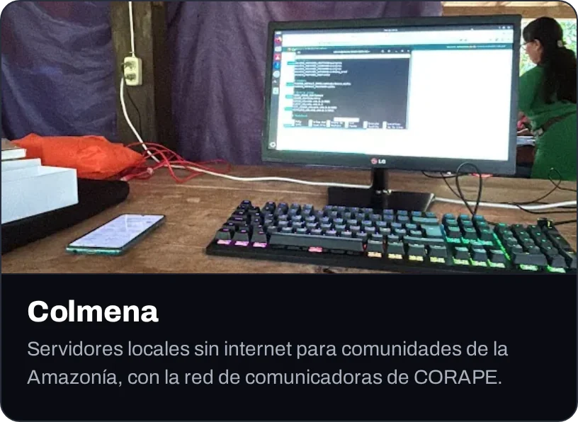

<a href="https://joelsphere.com">
<picture>
  <source media="(prefers-reduced-motion: reduce) and (max-width: 640px)" srcset="img/hero-vertical-quieto.webp">
  <source media="(prefers-reduced-motion: reduce)" srcset="img/hero-quieto.webp">
  <source media="(max-width: 640px)" srcset="img/hero-vertical.webp">
  
</picture>
</a>

Construyo software que entra en operación: plataformas, agentes de IA e infraestructura que alguien usa al día siguiente de desplegarlos.

## Hoy

<a href="https://insideebb.com">
<picture>
  <source media="(max-width: 640px)" srcset="img/t-insideebb-movil.webp">
  
</picture>
</a>

- **[INSIDEEBB](https://insideebb.com), cofundador y CTO.** Dirijo el desarrollo de [Bizzio](https://bizzio.shop), nuestra plataforma de comercio electrónico con IA, y diseño y dicto capacitaciones en IA aplicada para equipos de empresa.
- **[UIT, Generation Connect Américas](https://www.itu.int/generationconnect/generation-connect-americas-youth-envoys-gc-ams-2026-2030/), Youth Envoy 2026-2030.** Represento a Ecuador en el programa de juventud de la agencia de las Naciones Unidas para las tecnologías digitales.
- **Universidad Indoamérica, Centro de Inteligencia Artificial.** Desarrollo los sistemas internos que usa la universidad en su gestión diaria.
- **Sector público.** Plataformas para programas de transformación digital y emprendimiento.

## Proyectos

## Investigación y charlas

- **[Ingeniería de una plataforma web para la evaluación de la madurez digital de microemprendimientos ecuatorianos](https://doi.org/10.37815/rte.v38nE1.1591).** Revista Tecnológica ESPOL, 38(E1), 154-171, 2026. Con Ivanna Sánchez-Montero y Viviana Cajas-Cajas.
- **Diseño de un elevador de carga como medida para reducir riesgos ergonómicos.** Artículo indexado en Scopus, en coautoría, 2024.
- **Charlas.** TICEC 2026, Track Técnico · Ingenia X 2026 · Semana de la Interculturalidad 2025, *Voces de la Amazonía* · FLISOL 2024, *GNU/Linux: la montaña rusa de la ingeniería*.

## Con qué trabajo

- **Inteligencia artificial.** Agentes, RAG, modelos locales y en la nube, evaluación y seguridad.
- **Desarrollo.** TypeScript, Python, Node.js, NestJS, FastAPI, React, Next.js, Three.js.
- **Infraestructura.** Linux, Docker, PostgreSQL, servidores propios y despliegue continuo.
