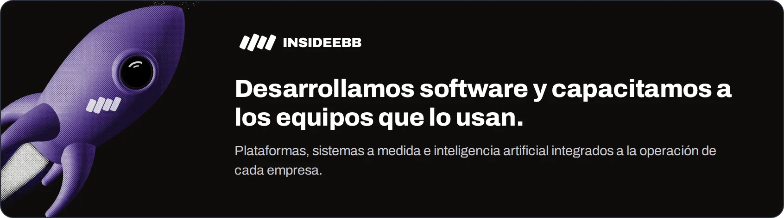
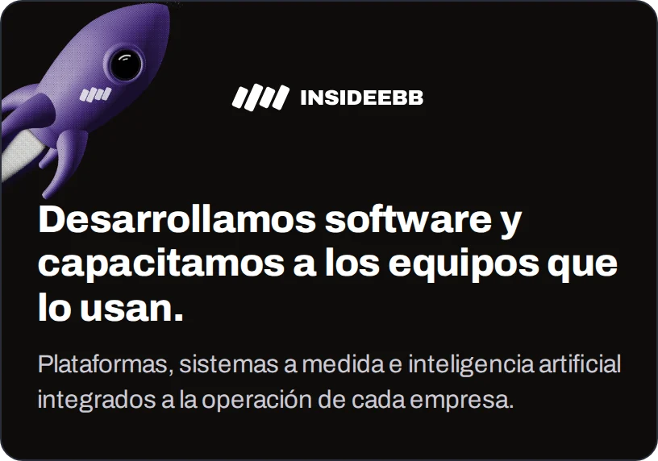
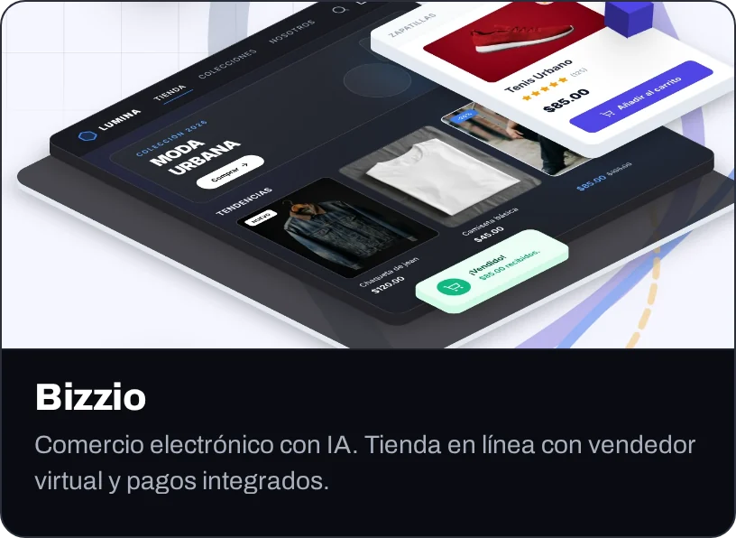
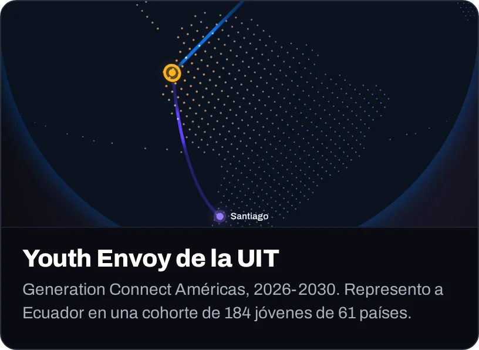
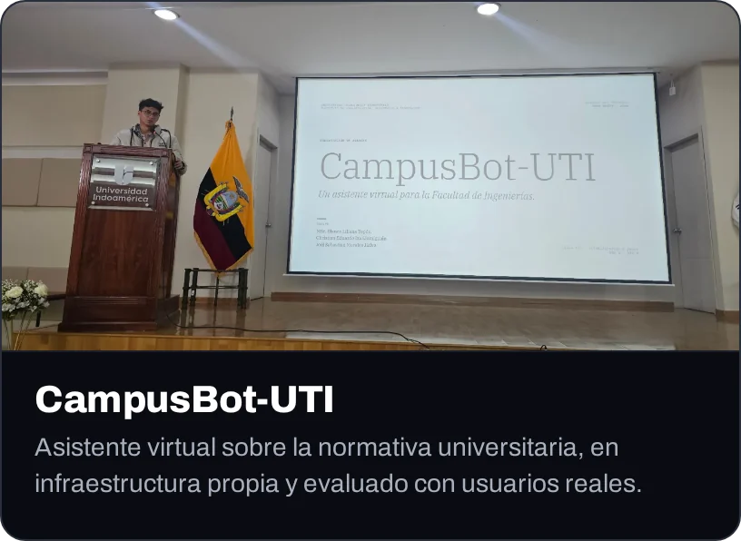
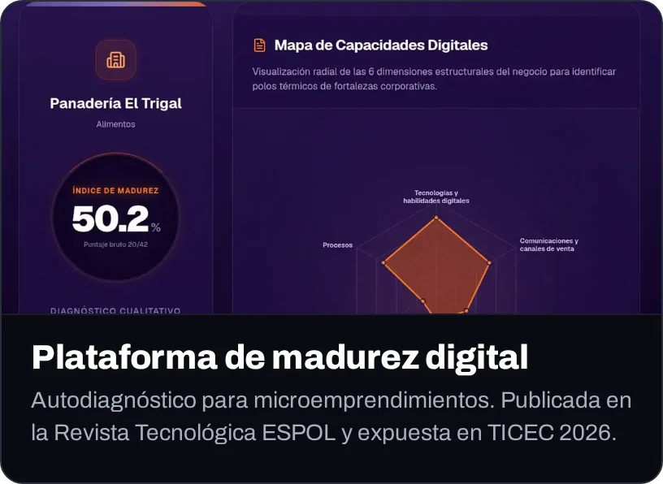
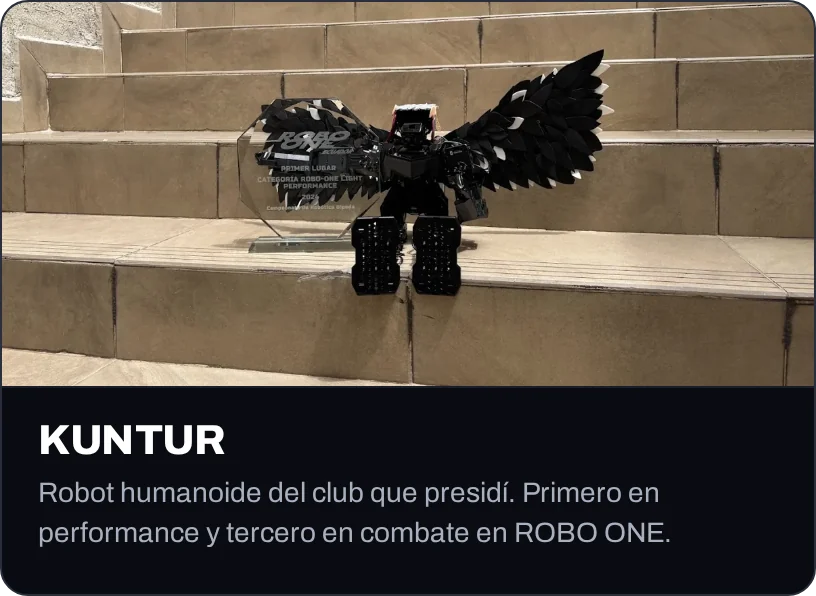
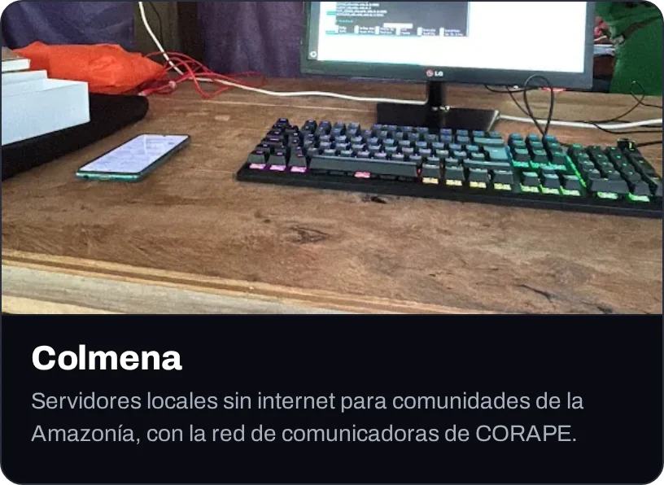

<a href="https://joelsphere.com"><picture><source media="(max-width: 640px), (prefers-reduced-motion: reduce)" srcset="img/nada.png"><source media="(prefers-color-scheme: light)" srcset="img/claro/hero.webp"><source media="(prefers-color-scheme: dark)" srcset="img/oscuro/hero.webp"></picture><picture><source media="(min-width: 641px), (prefers-reduced-motion: reduce)" srcset="img/nada.png"><source media="(prefers-color-scheme: light)" srcset="img/claro/hero-vertical.webp"><source media="(prefers-color-scheme: dark)" srcset="img/oscuro/hero-vertical.webp"></picture><picture><source media="(max-width: 640px), (prefers-reduced-motion: no-preference)" srcset="img/nada.png"><source media="(prefers-color-scheme: light)" srcset="img/claro/hero-quieto.webp"><source media="(prefers-color-scheme: dark)" srcset="img/oscuro/hero-quieto.webp"></picture><picture><source media="(min-width: 641px), (prefers-reduced-motion: no-preference)" srcset="img/nada.png"><source media="(prefers-color-scheme: light)" srcset="img/claro/hero-vertical-quieto.webp"><source media="(prefers-color-scheme: dark)" srcset="img/oscuro/hero-vertical-quieto.webp"></picture></a>

<a href="https://joelsphere.com"><picture><source media="(prefers-color-scheme: light)" srcset="img/claro/b-joelsphere.webp"><source media="(prefers-color-scheme: dark)" srcset="img/oscuro/b-joelsphere.webp"></picture></a>
<a href="https://insideebb.com"><picture><source media="(prefers-color-scheme: light)" srcset="img/claro/b-insideebb.webp"><source media="(prefers-color-scheme: dark)" srcset="img/oscuro/b-insideebb.webp"></picture></a>
<a href="https://www.linkedin.com/in/j03l1725"><picture><source media="(prefers-color-scheme: light)" srcset="img/claro/b-linkedin.webp"><source media="(prefers-color-scheme: dark)" srcset="img/oscuro/b-linkedin.webp"></picture></a>
<a href="https://x.com/j03l1725"><picture><source media="(prefers-color-scheme: light)" srcset="img/claro/b-x.webp"><source media="(prefers-color-scheme: dark)" srcset="img/oscuro/b-x.webp"></picture></a>
<a href="https://www.instagram.com/joel.morales03_/"><picture><source media="(prefers-color-scheme: light)" srcset="img/claro/b-instagram.webp"><source media="(prefers-color-scheme: dark)" srcset="img/oscuro/b-instagram.webp"></picture></a>
<a href="https://orcid.org/0009-0009-9661-8529"><picture><source media="(prefers-color-scheme: light)" srcset="img/claro/b-orcid.webp"><source media="(prefers-color-scheme: dark)" srcset="img/oscuro/b-orcid.webp"></picture></a>
<a href="mailto:joelm@insideebb.com"><picture><source media="(prefers-color-scheme: light)" srcset="img/claro/b-correo.webp"><source media="(prefers-color-scheme: dark)" srcset="img/oscuro/b-correo.webp"></picture></a>

Construyo software que entra en operación: plataformas, agentes de IA e infraestructura que alguien usa al día siguiente de desplegarlos.

## Hoy

<a href="https://insideebb.com"><picture><source media="(max-width: 640px)" srcset="img/nada.png"><source media="(prefers-color-scheme: light)" srcset="img/claro/t-insideebb.webp"><source media="(prefers-color-scheme: dark)" srcset="img/oscuro/t-insideebb.webp"></picture><picture><source media="(min-width: 641px)" srcset="img/nada.png"><source media="(prefers-color-scheme: light)" srcset="img/claro/t-insideebb-movil.webp"><source media="(prefers-color-scheme: dark)" srcset="img/oscuro/t-insideebb-movil.webp"></picture></a>

- **[INSIDEEBB](https://insideebb.com), cofundador.** Desarrollo de software, inteligencia artificial aplicada y capacitación de equipos. [Bizzio](https://bizzio.shop) es nuestra plataforma de comercio electrónico con IA.
- **[UIT, Generation Connect Américas](https://www.itu.int/generationconnect/generation-connect-americas-youth-envoys-gc-ams-2026-2030/), Youth Envoy 2026-2030.** Represento a Ecuador en el programa de juventud de la agencia de las Naciones Unidas para las tecnologías digitales.
- **Universidad Indoamérica, Centro de Inteligencia Artificial.** Desarrollo los sistemas internos que usa la universidad en su gestión diaria.
- **Sector público.** Plataformas para programas de transformación digital y emprendimiento.

## Proyectos

<a href="https://bizzio.shop"><picture><source media="(prefers-color-scheme: light)" srcset="img/claro/t-bizzio.webp"><source media="(prefers-color-scheme: dark)" srcset="img/oscuro/t-bizzio.webp"></picture></a>
<a href="https://www.itu.int/generationconnect/generation-connect-americas-youth-envoys-gc-ams-2026-2030/"><picture><source media="(prefers-color-scheme: light)" srcset="img/claro/t-uit.webp"><source media="(prefers-color-scheme: dark)" srcset="img/oscuro/t-uit.webp"></picture></a>
<a href="https://joelsphere.com/escritos/titulacion-campusbot/"><picture><source media="(prefers-color-scheme: light)" srcset="img/claro/t-campusbot.webp"><source media="(prefers-color-scheme: dark)" srcset="img/oscuro/t-campusbot.webp"></picture></a>
<a href="https://doi.org/10.37815/rte.v38nE1.1591"><picture><source media="(prefers-color-scheme: light)" srcset="img/claro/t-madurez.webp"><source media="(prefers-color-scheme: dark)" srcset="img/oscuro/t-madurez.webp"></picture></a>
<a href="https://joelsphere.com"><picture><source media="(prefers-color-scheme: light)" srcset="img/claro/t-kuntur.webp"><source media="(prefers-color-scheme: dark)" srcset="img/oscuro/t-kuntur.webp"></picture></a>
<a href="https://joelsphere.com"><picture><source media="(prefers-color-scheme: light)" srcset="img/claro/t-colmena.webp"><source media="(prefers-color-scheme: dark)" srcset="img/oscuro/t-colmena.webp"></picture></a>

## Investigación y charlas

- **[Ingeniería de una plataforma web para la evaluación de la madurez digital de microemprendimientos ecuatorianos](https://doi.org/10.37815/rte.v38nE1.1591).** Revista Tecnológica ESPOL, 38(E1), 154-171, 2026. Con Ivanna Sánchez-Montero y Viviana Cajas-Cajas.
- **Diseño de un elevador de carga como medida para reducir riesgos ergonómicos.** Artículo indexado en Scopus, en coautoría, 2024.
- **Charlas.** TICEC 2026, Track Técnico · Ingenia X 2026 · Semana de la Interculturalidad 2025, *Voces de la Amazonía* · FLISOL 2024, *GNU/Linux: la montaña rusa de la ingeniería*.

## Con qué trabajo

- **Inteligencia artificial.** Agentes, RAG, modelos locales y en la nube, evaluación y seguridad.
- **Desarrollo.** TypeScript, Python, Node.js, NestJS, FastAPI, React, Next.js, Three.js.
- **Infraestructura.** Linux, Docker, PostgreSQL, servidores propios y despliegue continuo.
